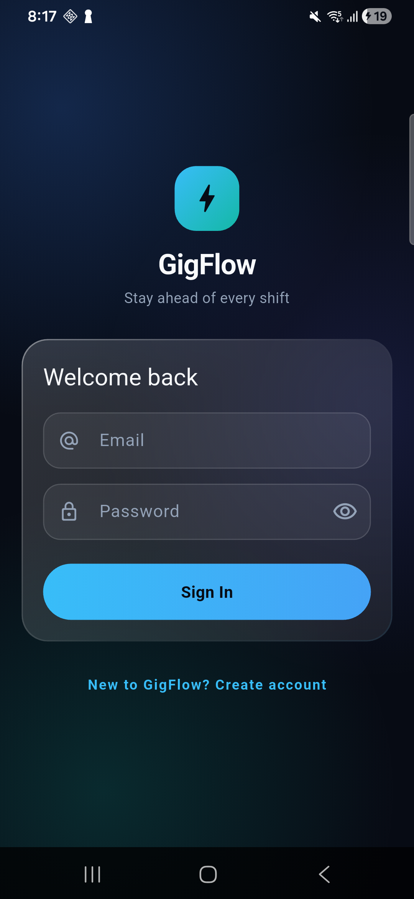
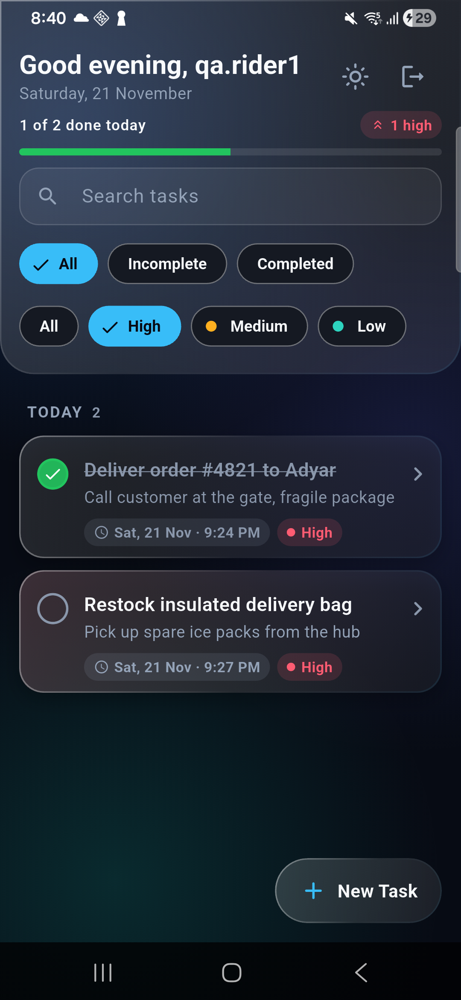
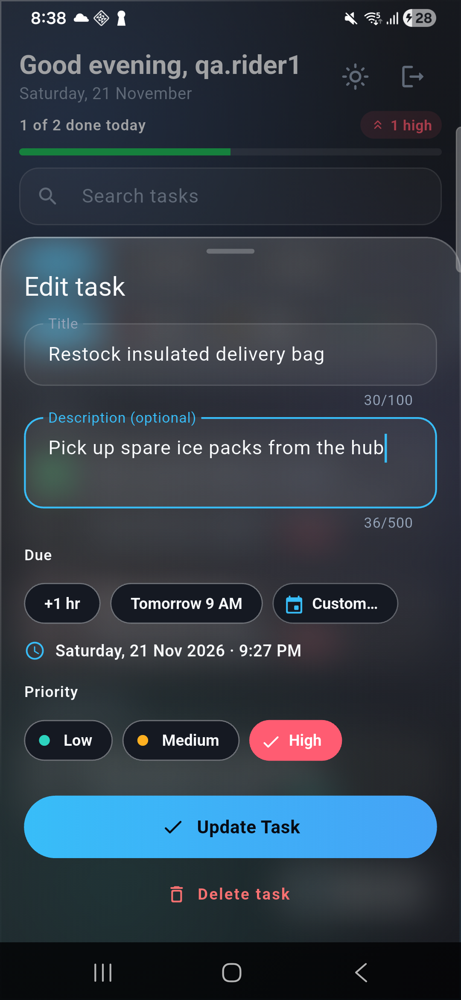
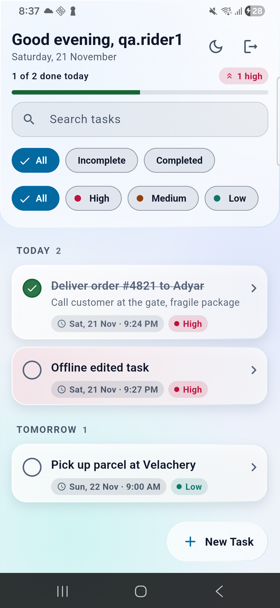

# GigFlow — Task Management for Gig Workers

An offline-first Flutter task manager for delivery riders, rideshare drivers and shift freelancers. Built for the **Whatbytes Flutter Developer Intern** assignment with Firebase Authentication, Cloud Firestore (with local offline persistence), strict earliest-to-latest due-date sorting, priority + status filtering, and a performance-engineered **Liquid Glass** UI.

- **Android Release APK:** see the [GitHub Releases](../../releases) page (`gigflow-v1.0.0-universal.apk`)
- **Walkthrough video:** _add link here_

## Screenshots (release build, Samsung Galaxy SM-E346B, Android 16)

| Login | Dashboard (dark) | Priority filter | Create / edit task | Dashboard (light) |
| :---: | :---: | :---: | :---: | :---: |
|  |  |  |  |  |

---

## Features

| Area | What you get |
|---|---|
| **Auth** | Email/password register & login, persistent session (auto-login on relaunch), logout with confirmation, clear human-readable errors for every Firebase code (`invalid-credential`, `wrong-password`, `user-not-found`, `email-already-in-use`, `weak-password`, `invalid-email`, `too-many-requests`, `network-request-failed`, …), password visibility toggle, trimmed email, double-submit protection |
| **Tasks** | Create, view, edit, delete (swipe or from editor) with 4-second **Undo**, one-tap complete/incomplete with haptics. Fields: `title`, `description`, `dueDate`, `priority` (low/medium/high), `isCompleted` |
| **Offline** | Firestore disk persistence (`CACHE_SIZE_UNLIMITED`). Everything works in Airplane Mode and syncs automatically on reconnect; an **Offline / Syncing** indicator shows the real sync state |
| **Filter & sort** | Priority (All/High/Medium/Low) × Status (All/Incomplete/Completed) × instant search; always sorted **earliest → latest** (ties: high priority first, then creation time). Grouped into OVERDUE/EARLIER, TODAY, TOMORROW, UPCOMING without ever breaking global order |
| **Shift dashboard** | "X of Y done today" progress bar, overdue and open-high-priority counters, overdue badges per task |
| **Quick due presets** | `+1 hr`, `Today 6 PM`, `Tomorrow 9 AM`, or a custom date/time (Cupertino picker on iOS, Material on Android) |
| **UI** | Material 3, Dark "Obsidian Glass" and Light "Daylight Frost" themes (persisted), WCAG AA contrast, 48dp touch targets, safe areas, keyboard-safe sheets, responsive up to tablets (640px content column) |

## Reviewer quick install (Android)

1. Download `gigflow-v1.0.0-universal.apk` from Releases.
2. Open it on the phone (allow "Install unknown apps"), or install it over USB:
   ```bash
   adb install -r gigflow-v1.0.0-universal.apk
   ```
3. Register any email and password (at least 6 characters, with a letter and a number).

## Architecture

Feature-first Clean Architecture with BLoC:

```text
lib/
├── app/          # MaterialApp.router, get_it DI, go_router auth guards, theme + ThemeCubit
├── core/         # Error mapping, validators, connectivity/sync status, Liquid Glass widgets
├── dev/          # Demo data seeder (debug/profile builds only)
└── features/
    ├── auth/     # domain (AppUser, AuthRepository) → data (FirebaseAuth) → presentation (AuthBloc, screens)
    └── tasks/    # domain (TaskEntity, TaskQueryEngine, DateGrouping, ShiftStats, presets)
                  # → data (TaskModel mapper, FirestoreTaskRepository, prefs)
                  # → presentation (TaskBloc, TaskFilterCubit, dashboard, editor sheet)
```

### Key engineering decisions

1. **Zero-lag Liquid Glass (2-tier rendering).** A real `BackdropFilter` blur is used only on chrome (the pinned header/filter dock, the floating "New Task" pill, the editor sheet and the auth card). That means **at most 2 live blurs while scrolling**. Every scrolling task card is a zero-blur "specular" card: a translucent gradient plus a custom-painted 1.2px refractive rim, with no clip, no `Opacity` and no `saveLayer`. A widget test enforces that no `BackdropFilter` ever appears inside a task tile.
2. **Offline-first writes.** Firestore applies writes to the local cache immediately (latency compensation), but the returned future only completes on *server* acknowledgement. The UI therefore **never awaits writes**, so nothing hangs in Airplane Mode. Server rejections are surfaced as SnackBars. Timestamps are client-generated (never `serverTimestamp()`), so there are no null-timestamp crashes on pending local snapshots.
3. **Deterministic sort + monotonic grouping.** `TaskQueryEngine` is a pure-Dart total order (`dueDate → priority → createdAt → id`). Sections are bucketed purely by time thresholds, so flattening the sections always equals the sorted list. A property test over 200 random tasks checks this.
4. **Filtering in memory.** Firestore runs a single `orderBy('dueDate')` query (no composite indexes). Priority, status and search filters run locally, which makes them instant and lets them work offline.
5. **Auth-driven routing.** `go_router` redirects are driven by `AuthBloc` status changes only (a distinct `(status, uid)` stream), and the router is created once and disposed by DI. `TaskBloc` is scoped to the `/tasks` route, so signing out closes its Firestore listener and no data leaks between accounts.
6. **Tenant-isolated security rules.** `users/{uid}/tasks/{taskId}` is readable and writable only by its owner, with schema validation (`firestore.rules`).

## Tech stack

Flutter 3.47.5 (Dart 3.13) · `flutter_bloc` 9 + `bloc_concurrency` · `equatable` 3 · `firebase_core` 5 / `firebase_auth` 7 / `cloud_firestore` 7 · `go_router` 18 · `get_it` 9 · `shared_preferences` 2.5 (`SharedPreferencesWithCache`) · `connectivity_plus` 7 · `intl` · tests: `flutter_test`, `bloc_test` 10, `mocktail`.

Android: minSdk 24, target/compile SDK 36, R8 minify + resource shrinking enabled. iOS: deployment target 15.0.

## Run locally

```bash
flutter pub get
flutter analyze
flutter test
flutter run
```

The repo ships with the Firebase client config for the demo project (`lib/firebase_options.dart`, `google-services.json`, `GoogleService-Info.plist`). These are public identifiers; access is enforced by `firestore.rules`.

### Use your own Firebase project

1. Create a Firebase project, enable **Authentication → Email/Password**, and create a **Firestore** database.
2. Run `flutterfire configure --platforms=android,ios`.
3. Run `firebase deploy --only firestore:rules`.

## Verified on a real device

The **release APK** (R8-minified) was exercised end-to-end on a Samsung Galaxy SM-E346B (Android 16) against the live Firebase project:

| Scenario | Result |
|---|---|
| Cold start → login screen; empty-form and bad-email validation | ✅ |
| Wrong credentials → "Incorrect email or password…" (Firebase `invalid-credential`) | ✅ |
| Register → auto-redirect to dashboard; kill & relaunch stays signed in | ✅ |
| Create tasks with presets/priorities → instant, sorted earliest → latest, grouped TODAY/TOMORROW | ✅ |
| Toggle complete → strike-through, shift progress bar + high-priority counter update | ✅ |
| Filters: Completed / Incomplete + High (empty state + Clear) / search "airport" | ✅ |
| Swipe delete → Undo restores in place; SnackBar auto-hides after 4 s | ✅ |
| **Airplane Mode:** create + edit offline (no spinner), "Offline" indicator, kill & relaunch offline → data intact | ✅ |
| Reconnect → syncs; **wipe app data + fresh login → all offline edits come back from Firestore** | ✅ |
| Dark ↔ light theme (persisted), logout confirmation, no error flash after sign-out | ✅ |

Issues found during this pass and fixed (each now covered by a regression test):
- a stale login error carried over to the register screen
- keyboard "Next" focused the password-visibility icon
- the editor's Save button sat under the Android 15+ edge-to-edge navigation bar
- light-mode chip labels were lost after the animated theme switch
- a preset chip lost its highlight after a minute

## Tests

84 automated tests:

| Suite | Covers |
|---|---|
| `firebase_error_mapper_test` | Every auth error code + fallback |
| `validators_test` | Email, login/new/confirm password, task fields |
| `task_query_engine_test` | Earliest→latest, priority/createdAt/id tie-breaks, each filter, combined filters, search, immutability |
| `date_grouping_test` | Monotonic sections, boundaries, labels, 200-task property test |
| `shift_and_presets_test` | Today window, overdue counts, preset availability & rollover |
| `task_model_test` | Firestore round-trip, pending (null) timestamps, malformed data |
| `auth_bloc_test` | Stream mapping, submit states, failure, double-submit dropped, logout |
| `task_bloc_test` | Create/update/toggle/delete/undo, optimistic hide, pruning, stream & write errors |
| `task_filter_cubit_test` | Persistence + reset |
| `login_screen_test` / `register_screen_test` | Validation, error banner, stale-error clearing, keyboard focus order, visibility toggle, disabled CTA, a11y guidelines |
| `dashboard_test` | **Blur budget** (no blur in tiles, ≤ 2 total), section order, empty states, offline pill, toggle, light-theme chip legibility |

## Known limitations

- iOS is code-complete and statically verified, but not device-tested (built on Windows, no macOS available).
- Long-press the greeting in a debug/profile build to seed 60 demo tasks for profiling.
