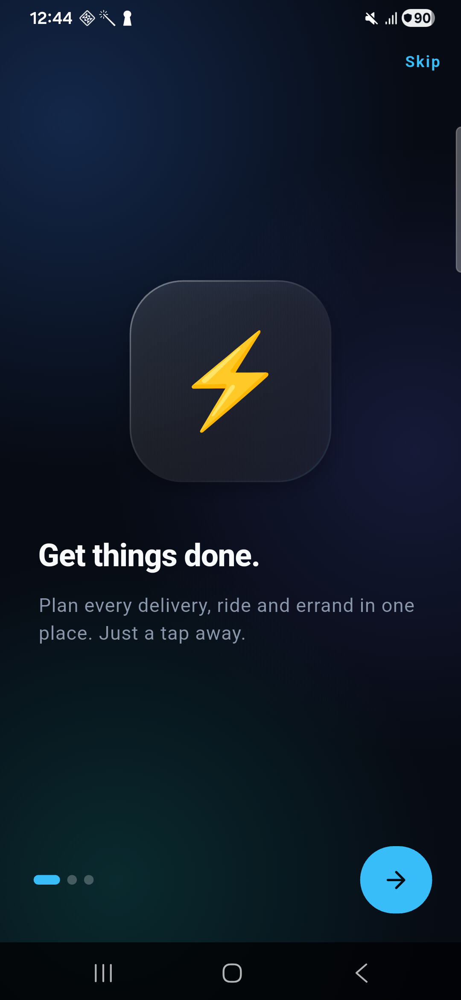
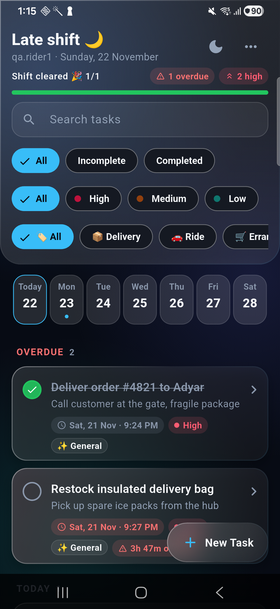
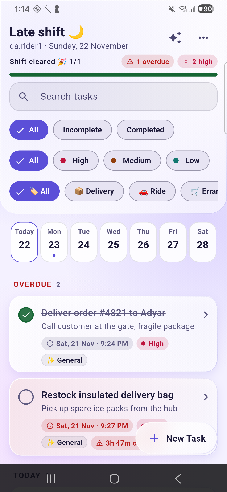
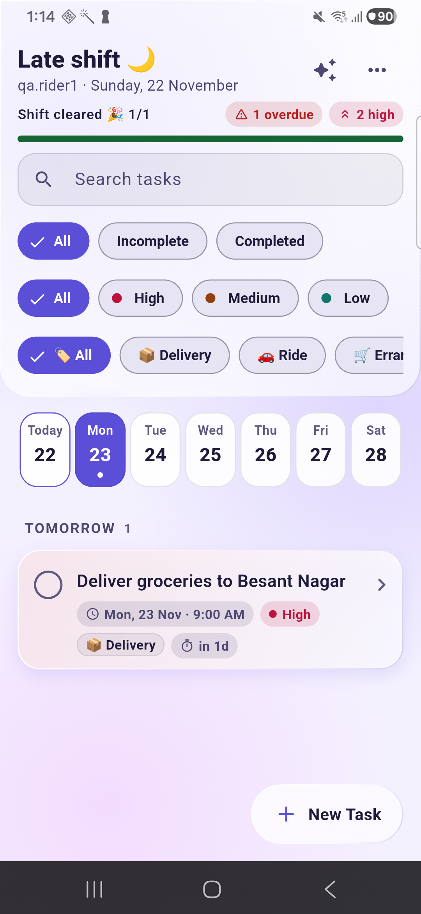
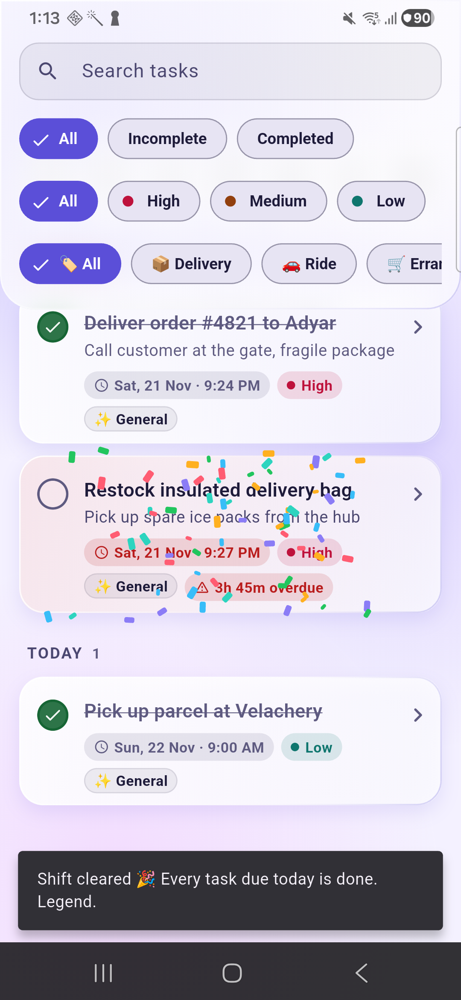
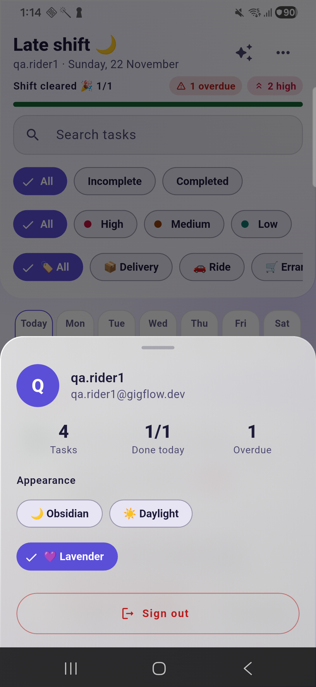

# GigFlow — Task Management for Gig Workers

An offline-first Flutter task manager for delivery riders, rideshare drivers and shift freelancers. Built for the **Whatbytes Flutter Developer Intern** assignment with Firebase Authentication (email/password + Google), Cloud Firestore with local offline persistence, strict earliest-to-latest due-date sorting, priority/status/category filtering, and a performance-engineered **Liquid Glass** UI.

- **Android APK:** [GitHub Releases](../../releases/latest) → `gigflow-v1.1.0-universal.apk`
- **Walkthrough video:** _optional, add link here_

## Screenshots (release build on a Samsung Galaxy SM-E346B, Android 16)

| Onboarding | Login | Dashboard | Lavender theme |
| :---: | :---: | :---: | :---: |
|  |  |  |  |

| Create / edit task | Week strip + day filter | Category filter | Shift cleared 🎉 | Profile |
| :---: | :---: | :---: | :---: | :---: |
|  |  |  |  |  |

---

## Features

### Assignment requirements
| Requirement | How GigFlow does it |
|---|---|
| **Register / login (Firebase email + password)** | Persistent session, logout with confirmation, password visibility toggle, trimmed email, double-submit protection |
| **Error messages for invalid credentials** | Every Firebase code mapped to plain English (`invalid-credential`, `wrong-password`, `user-not-found`, `email-already-in-use`, `weak-password`, `too-many-requests`, `network-request-failed`, …) |
| **Create, edit, delete, view tasks** | Bottom-sheet editor, swipe-left delete with 4-second **Undo**, tap to edit |
| **Title, description, due date, priority** | Plus an emoji category; quick due presets (`+1 hr`, `Today 6 PM`, `Tomorrow 9 AM`, custom picker) |
| **Stored on Firebase + local storage** | Cloud Firestore with unlimited offline cache; filters, theme and onboarding state persisted locally |
| **Mark complete / incomplete** | One-tap checkbox or **swipe right**, with haptics |
| **Filter by priority and status** | Plus category, a 7-day **week strip** day filter, and instant search |
| **Sorted by due date (earliest → latest)** | Deterministic total order, grouped into OVERDUE · TODAY · TOMORROW · THIS WEEK · LATER without ever breaking that order |
| **Clean, responsive Material UI on iOS & Android** | Material 3, safe areas, keyboard-safe sheets, 48dp touch targets, WCAG AA contrast in all three themes |

### Extras
- **One-time onboarding** (3 slides) before login.
- **Forgot password** sheet and a ✓ tick on valid emails.
- **Continue with Google**: native account picker (Android Credential Manager) → Firebase.
- **Relative due times** ("in 45m", "2h overdue") and a time-of-day greeting.
- **Shift dashboard**: "X of Y done today" progress, overdue and open-high counters, **confetti + "Shift cleared 🎉"** when today's last task is done.
- **Profile sheet** ("⋯"): stats, appearance picker, sign out.
- **Three themes**: Obsidian (dark), Daylight (light), **Lavender**, all persisted.
- **Offline indicator** ("Offline — changes are saved on this device" / "Syncing…").

## Reviewer quick install (Android 7.0+)

1. Download `gigflow-v1.1.0-universal.apk` from [Releases](../../releases/latest) and open it on the phone (allow "Install unknown apps"), or run `adb install -r gigflow-v1.1.0-universal.apk`.
2. Register with any email and a password of 6+ characters that includes a letter and a number, or tap **Continue with Google**.

## Architecture

Feature-first Clean Architecture with BLoC:

```text
lib/
├── app/          # MaterialApp.router, get_it DI, go_router guards (onboarding → auth → tasks), themes
├── core/         # Error mapping, validators, connectivity/sync status, OAuth config, glass widgets, confetti
├── dev/          # Demo data seeder (debug/profile builds only)
└── features/
    ├── auth/     # domain (AppUser, AuthRepository) → data (FirebaseAuth + Google) → presentation (AuthBloc, onboarding/login/register)
    └── tasks/    # domain (TaskEntity, TaskCategory, TaskQueryEngine, DateGrouping, ShiftStats, RelativeDue, presets)
                  # → data (TaskModel mapper, FirestoreTaskRepository, prefs)
                  # → presentation (TaskBloc, TaskFilterCubit, dashboard, editor, week strip, profile)
```

### Key engineering decisions

1. **Zero-lag Liquid Glass (2-tier rendering).** A real `BackdropFilter` blur is used only on chrome (the pinned header/filter dock, the "New Task" pill, sheets and the auth card), so there are at most 2 live blurs while scrolling. Task cards are zero-blur "specular" cards: a gradient plus a custom-painted rim, with no clip, no `Opacity` and no `saveLayer`. A widget test enforces "no blur inside a task tile".
2. **Offline-first writes.** Firestore updates the local cache immediately; the UI never awaits server acknowledgement, so nothing hangs in Airplane Mode. Server rejections surface as SnackBars. Timestamps are client-generated, so there are no null `serverTimestamp()` crashes.
3. **Deterministic sort + monotonic grouping.** A pure-Dart total order (`dueDate → priority → createdAt → id`). Sections are bucketed purely by time, so flattening them equals the sorted list (checked by a 200-task property test).
4. **In-memory filtering.** Firestore runs a single `orderBy('dueDate')` query (no composite indexes). Priority, status, category, day and search filters run locally, so they're instant and work offline.
5. **Auth-driven routing.** `go_router` redirects react only to `(status, uid)` changes. `TaskBloc` is scoped to the `/tasks` route, so signing out closes the Firestore listener and nothing leaks between accounts.
6. **Native Google sign-in.** Native Google sign-in on Android avoids the browser-redirect flow, which breaks under Chrome storage partitioning ("missing initial state").
7. **Theme-safe styling.** Chip colours are resolved inside theme-dependent contexts, so nothing goes stale during the animated theme switch (a bug found and fixed on a real device).
8. **Secure, backward-compatible rules.** `users/{uid}/tasks/{taskId}` is owner-only with schema validation; the new `category` field is optional, so v1.0 clients keep working.

## Tech stack

Flutter 3.47.5 (Dart 3.13) · `flutter_bloc` 9 + `bloc_concurrency` · `equatable` 3 · `firebase_core` 5 / `firebase_auth` 7 / `cloud_firestore` 7 · `google_sign_in` 7 · `go_router` 18 · `get_it` 9 · `shared_preferences` 2.5 · `connectivity_plus` 7 · `intl` · tests: `flutter_test`, `bloc_test` 10, `mocktail`.

Android: minSdk 24, target/compile SDK 36, R8 + resource shrinking, release-signed. iOS: deployment target 15.0.

## Run locally

```bash
flutter pub get
flutter analyze
flutter test
flutter run
```

The repo ships the Firebase client config for the demo project (`lib/firebase_options.dart`, `google-services.json`, `GoogleService-Info.plist`). These are public identifiers; access is enforced by `firestore.rules`.

Release signing reads `android/key.properties` (gitignored). Without it, release builds fall back to the debug key, and Google sign-in then needs that key's SHA-1 registered in Firebase.

## Tests

**95 automated tests** (unit, BLoC, widget):

| Suite | Covers |
|---|---|
| `firebase_error_mapper_test`, `validators_test` | Every auth error code, all form validators |
| `task_query_engine_test`, `new_features_test` | Sorting and tie-breaks, priority/status/category/day filters, search, relative due labels, greetings, category model round-trip and legacy docs |
| `date_grouping_test`, `shift_and_presets_test` | Monotonic sections incl. This week/Later, boundaries, shift stats, celebration trigger, presets |
| `task_model_test` | Firestore round-trip, pending (null) timestamps, malformed data |
| `auth_bloc_test`, `task_bloc_test`, `task_filter_cubit_test` | Auth flows + double-submit, CRUD/undo/pending-delete/errors, persisted filters and day toggling |
| `login_screen_test`, `register_screen_test` | Validation, banners, stale-error clearing, keyboard focus order, a11y guidelines |
| `dashboard_test` | Blur budget, section order, empty states, offline pill, light-theme legibility |

## Verified on a real device

The release APK was tested end-to-end on a Samsung Galaxy SM-E346B (Android 16) against the live Firebase project:
- onboarding
- email login/register and error messages
- Google sign-in
- create/edit/delete/undo
- swipe to complete and the confetti celebration
- priority, status, category, day and search filters
- the Airplane Mode round-trip: offline edits survived an app restart, then came back from the server after wiping local data
- all three themes
- profile sheet and logout

Issues found on the device were fixed, each with a regression test where practical:
- Save button under the Android 15+ navigation bar
- light-mode chip contrast after a theme switch
- keyboard "Next" focusing the eye icon
- stale login error on the register screen
- Google browser-redirect failure
- a narrow-screen Google button overflow

## Known limitations

- iOS is code-complete and statically checked, but not device-tested (no macOS build host).
- Long-press the greeting in a debug/profile build to seed 60 demo tasks for profiling.
